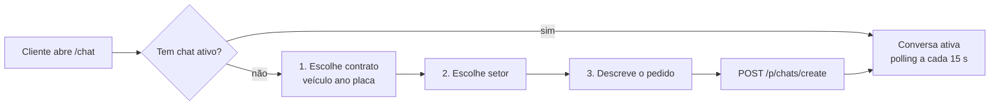

# Mapeamento – Portal do Cliente (Sete Capital → Quadrum)

Mapeado em 15/10/2026 a partir da visão de cliente (UI + bundle front-end). Dados pessoais do cliente logado foram omitidos.

## Visão geral e stack técnica

O portal é uma SPA pequena de 3 telas (Login, Meus Contratos, Chat) que só lê dados do CRM interno e permite ao cliente abrir e responder atendimentos. Tudo o que aparece aqui é gerado por um back-office (CRM) com contratos, histórico de ocorrências e chats por setor.

| Item | O que foi encontrado |
| --- | --- |
| Front-end | Angular (build de produção) + Angular Material |
| Fonte / ícones | Roboto + Material Icons (Google Fonts) |
| Anti-robô | Google reCAPTCHA v2 no login |
| API | REST separada, autenticação Bearer token |
| Sessão | Objeto `currentCustomer` (dados + token) salvo no `localStorage` |
| Tempo real | Não há WebSocket: o chat faz polling a cada 15 s |
| Integrações externas | Sistema de assinatura digital (modelos de documento) e link para a página do contrato no CRM |

## Rotas e telas

| Rota | Componente | O que faz |
| --- | --- | --- |
| `/login` | app-login | Login por CPF + senha + reCAPTCHA |
| `/contratos` (e `/`) | app-contracts | Lista de contratos do cliente, com abas Dados / Histórico / Atendimentos |
| `/chat` | app-chat | Abre um atendimento novo (fluxo guiado) ou continua o atendimento ativo |
| `/chat/arquivado/:chatId` | app-chat | Visualiza um atendimento já encerrado (somente leitura) |
| `**` | — | Qualquer outra rota redireciona |

Todas as rotas, menos `/login`, ficam atrás de um guard: sem cliente logado, vai para o login. Um interceptor HTTP adiciona `Authorization: Bearer <token>` em toda chamada à API e outro trata erros (provável logout em 401).

## Login

O cliente entra com CPF e senha; não existe cadastro nem "esqueci minha senha" no portal.

- Título: "Portal do Cliente [Empresa]"
- Campos: CPF (com máscara), Senha, reCAPTCHA; botão ENTRAR
- Texto de ajuda: "Para obter sua senha ligue para 0800 … ramal …" — a senha é gerada/entregue pelo time interno
- Chamada: `POST /customers/authenticate` com `{cpf, password}` → retorna o cliente + token, salvo no `localStorage`
- `POST /authenticate/token_validate` valida o token salvo ao recarregar a página
- Sair: apaga o `localStorage` e volta para `/login`

## Layout e menu lateral

Layout de duas colunas: menu fixo escuro à esquerda (300 px) e conteúdo à direita sobre fundo com marca d'água do logo.

- Topo do menu: logo + nome da empresa
- Bloco do cliente: nome (22 px) e CPF formatado
- Itens: Meus Contratos (ícone `text_snippet`), Atendimento via Chat (ícone `chat`), Sair (ícone `exit_to_app`)
- Item ativo com fundo na cor de destaque e texto escuro
- Mobile: o menu vira barra com botão hambúrguer que expande o menu em tela cheia

## Meus Contratos

Cada contrato vira um painel expansível ("CONTRATO #id") com três abas. Ao abrir a tela, o portal busca os contratos e, para cada um, o histórico e os chats, e marca o contrato como lido.

**Avisos no topo (só quando aplicável)**

- Sem contratos: "Infelizmente não foi possível localizar contratos aceitos para seu CPF… entre em contato com seu consultor!"
- "Novas mensagens no chat!" — card clicável que leva a `/chat`; aparece quando há mensagem da equipe não lida em chat não arquivado
- "Atenção! Você tem uma mensagem urgente…" — aparece quando há registro de histórico dos departamentos 4 ou 9 não lido
- "Pendências contrato #id" — acordeão com documentos a assinar, cada item com botão de assinatura (ícone `gesture`)

**Aba DADOS**

| Campo | Campo da API |
| --- | --- |
| Data (por extenso: "Segunda-Feira, 1 de Março de 2021") | `acceptance_date` |
| Banco | `bank_name` |
| Linha de crédito (ex.: Veicular) | `credit_line` |
| Placa | `placa` |
| Consultor | `responsible_name` |
| Unidade (cidade, UF) | `partnership_name` |
| Selo "CONTRATO CANCELADO" | `canceled` (booleano) |

**Aba HISTÓRICO**

Linha do tempo de ocorrências lançadas pela equipe interna. Cada item é um card destacado com o texto (`notes`, quebras de linha preservadas, HTML permitido) e o rodapé "Autor em dd/MM/yyyy às HH:mm". Registros dos departamentos 4 e 9 ficam ocultos na lista, mas disparam o aviso de mensagem urgente.

**Aba ATENDIMENTOS**

Lista de chats do contrato, pelo título. Chat ativo: botão (ícone `chat`) que abre `/chat`. Chat arquivado: ícone `archive` que abre `/chat/arquivado/:id`. Sem chats: "Nenhum atendimento encontrado!".

**Assinatura de documentos**

O botão de assinatura redireciona para modelos diferentes conforme o tipo e se o cliente é PF ou PJ (CPF/CNPJ com mais de 14 caracteres = PJ):

| Documento | Destino |
| --- | --- |
| Termo | modelo de assinatura 241 |
| Contrato | página do contrato no CRM |
| Declaração | modelo 90 (PF) ou 92 (PJ) |
| Procuração | modelo 229 (PF) ou 230 (PJ) |

## Atendimento via chat

O cliente tem no máximo um chat ativo por vez: se já existe, o portal abre a conversa; se não, um robô conduz 3 perguntas e só então cria o atendimento no CRM.



O atendente responde pelo CRM e a resposta aparece no próximo ciclo de polling (15 s).

**Roteiro do robô (textos fixos no front-end)**

1. "Olá. Seja bem-vindo ao atendimento da [Empresa]."
2. "Para qual contrato você deseja atendimento?" → caixa com seletor Contrato (lista "veículo ano (placa)") + CONFIRMAR
3. "E com qual setor você deseja falar?" → seletor Setor: Acordo, Cobrança, Monitoramento, Ouvidoria + CONFIRMAR
4. "Por favor, nos fale resumidamente como podemos ajudá-lo?" → cliente digita no campo Mensagem
5. Ao enviar: `POST /p/chats/create` com título (= primeira mensagem), setor, contrato e as 8 mensagens iniciais (perguntas do robô, respostas do cliente e o fechamento "Obrigado por entrar em contato… sua solicitação foi encaminhada…")

Sem contratos ativos, o robô responde que não encontrou contratos e orienta a procurar o consultor.

**Tela da conversa**

- Balões: equipe à esquerda (fundo branco), cliente à direita (fundo destacado)
- Cabeçalho do balão: primeiro nome do autor (ou nome do robô se vazio) + "em dd/MM/yyyy às HH:mm"
- Rodapé: botão redondo Voltar, campo Mensagem, botão enviar (Enter também envia)
- Ao exibir mensagens da equipe, o portal marca cada uma como lida
- Chat arquivado: somente leitura

## API / endpoints

As rotas do portal ficam sob o prefixo `/p/`.

| Método | Rota | Uso |
| --- | --- | --- |
| POST | `/customers/authenticate` | Login `{cpf, password}` |
| POST | `/authenticate/token_validate` | Valida token salvo |
| GET | `/p/contracts/customer/:customerId` | Contratos do cliente |
| GET | `/p/contracts/:id` | Um contrato |
| GET | `/p/contracts/storie/read/:contractId` | Marca contrato/histórico como lido |
| GET | `/p/contracts/blank/:id` e `/p/contracts/blank/type/:type` | Modelos de documento para assinatura |
| GET | `/p/stories/:type/:id` | Histórico (type = "Contract") |
| GET | `/p/customers/contracts/:customerId` | Contratos ativos para o seletor do chat |
| GET | `/p/chats/customer/:customerId` | Chat ativo do cliente |
| GET | `/p/chats/contract/:contractId` | Chats de um contrato |
| GET | `/p/chats/:chatId` | Um chat (arquivado) |
| GET | `/p/chats/messages/:chatId` | Mensagens do chat |
| GET | `/p/chats/messages/:messageId/read/:chatId` | Marca mensagem como lida |
| GET | `/p/chats/check/:chatId/:creatorType` | Verifica não lidas |
| POST | `/p/chats/create` | Cria atendimento + mensagens iniciais |
| POST | `/p/chats/:chatId/add` | Envia mensagem `{chatId, message, creator_id, creator_type}` |

Na recriação, trocar os GET que alteram estado ("read") por POST/PATCH.

## Modelo de dados inferido

| Entidade | Campos usados pelo portal |
| --- | --- |
| Customer | id, name, cpf_cnpj, password, token |
| Contract | id, customer_id, acceptance_date, bank_name, credit_line, placa, vehicle, ano_modelo, responsible_name (consultor), partnership_name (unidade), canceled, contrato_id e ciencia_id (documentos assinados) |
| Story (histórico) | id, storiable_type ("Contract"), storiable_id, department_id, notes, author_name, created_at, read_at |
| Chat | id, title, chatable_type ("Customer"), chatable_id, contract_id, destination (setor), archived, creator_type |
| Message | id, chat_id, body, creator_type ("Customer" ou "User"), creator_id, author, created_at, read_at |
| Blank (modelo de documento) | id, type (termo, contrato, declaracao, procuracao), variante PF/PJ |

`creator_type = "User"` é o funcionário do CRM (ou o robô, `creator_id = 1`); `"Customer"` é o cliente. Mensagens aceitam negrito via `[b]...[/b]`.

## Nova identidade – Quadrum

Referências: `manual-marca-quadrum.png` e `paleta-quadrum.png` (em `docs/marca/`).

**Marca e mensagens**

- Nome: Quadrum · descritor: Assessoria Financeira
- Slogan: "Menos dívidas. Mais possibilidades."
- Assinatura: "Juntos pelo seu recomeço."
- Frase institucional: "A Quadrum é mais que uma assessoria. É o seu novo começo financeiro."
- Serviços (ícones de linha dourados): Negociação de dívidas, Redução de juros, Proteção do seu nome, Planejamento financeiro
- Personalidade: Confiável, Estratégica, Próxima (atendimento humanizado e direto), Focada em resultados
- Base: Natal-RN, atende todo o Brasil

**Paleta**

| Cor | Hex | Atributos |
| --- | --- | --- |
| Preto Onix | #0B0B0B | Confiança, sofisticação, autoridade |
| Dourado | #D4AF37 | Prosperidade, sucesso, resultados |
| Cinza Grafite | #2E2E2E | Equilíbrio, profissionalismo, estabilidade |
| Off White | #F5F5F5 | Clareza, simplicidade, modernidade |
| Azul Petróleo | #0E4A5A | Segurança, confiabilidade, estratégia |

**Tipografia**

- Montserrat — títulos e destaques (caixa alta com espaçamento largo entre letras)
- Inter — textos e informações
- Script dourado só na assinatura "Quadrum." — não usar na interface

**De → para no portal**

| Elemento | Hoje (Sete) | Quadrum |
| --- | --- | --- |
| Menu lateral | #363642 | Preto Onix #0B0B0B (separadores Cinza Grafite #2E2E2E) |
| Item ativo, aba ativa, botões principais | Amarelo #F6D331, texto preto | Dourado #D4AF37, texto Preto Onix |
| Fundo do conteúdo | Cinza claro + marca d'água | Off White #F5F5F5 + marca d'água do símbolo Q em baixa opacidade |
| Cards de histórico e balões do cliente | Amarelo-claro | Dourado ~10% de opacidade sobre branco |
| Links, ícones informativos, foco de campos | — | Azul Petróleo #0E4A5A |
| Botão voltar / erros | Vermelho #D42837 | Manter um vermelho só para erro/alerta (uso semântico) |
| Tela de login | Material padrão | Fundo Preto Onix, logo dourado, slogan, card do formulário em Cinza Grafite |
| Fonte | Roboto | Montserrat (títulos) + Inter (texto) |

**Textos a trocar**

- Login: "Portal do Cliente Quadrum" + telefone/ramal novos
- Robô do chat: "Olá. Seja bem-vindo ao atendimento da Quadrum." e "Obrigado por entrar em contato com a Quadrum…"; dar um nome ao robô
- Meta description, título da aba, favicon e `msapplication-TileColor` (#0B0B0B)

**Tokens para o código**

```css
:root {
  --q-onix: #0B0B0B;
  --q-gold: #D4AF37;
  --q-graphite: #2E2E2E;
  --q-offwhite: #F5F5F5;
  --q-petrol: #0E4A5A;
  --q-gold-soft: rgba(212, 175, 55, 0.10);
  --q-danger: #D42837;
  --q-font-title: 'Montserrat', sans-serif;
  --q-font-body: 'Inter', sans-serif;
}
```

Texto preto sobre dourado tem bom contraste; texto branco sobre dourado não — evitar em botões.

## O que o CRM interno precisa ter

1. Cadastro de clientes (CPF/CNPJ) com geração/reset de senha pela equipe
2. Cadastro de contratos com banco, linha de crédito, veículo/placa, consultor, unidade, data de aceite e status cancelado
3. Histórico por contrato com departamento, autor e controle de leitura pelo cliente (incluindo registros "urgentes" que só geram alerta)
4. Caixa de atendimentos por setor (Acordo, Cobrança, Monitoramento, Ouvidoria): lista de chats, responder, arquivar, indicador de não lidas
5. Documentos para assinatura (termo, contrato, declaração, procuração, variantes PF/PJ) e registro de quais já foram assinados
6. Cadastros de apoio: bancos, unidades/parceiros, consultores, departamentos/setores

## Pendências

- [ ] Logo Quadrum em SVG (símbolo Q e logotipo completo) e favicon
- [ ] Novo 0800 / WhatsApp para o texto do login
- [ ] Quais são os departamentos 4 e 9 (os que geram "mensagem urgente")?
- [ ] Veículo é o único bem financiado ou há outras linhas de crédito?
- [ ] Quem arquiva o chat (atendente, automação por tempo)?
- [ ] Sistema de assinatura será recriado ou mantido como integração?
